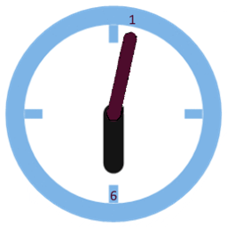
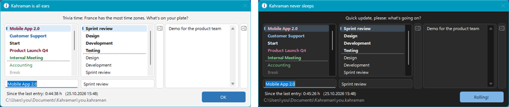
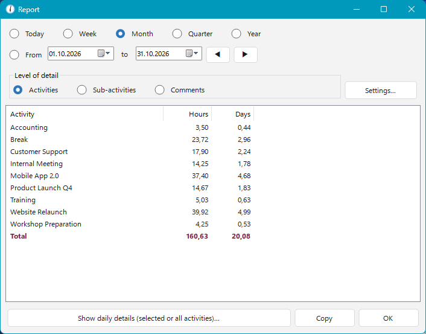
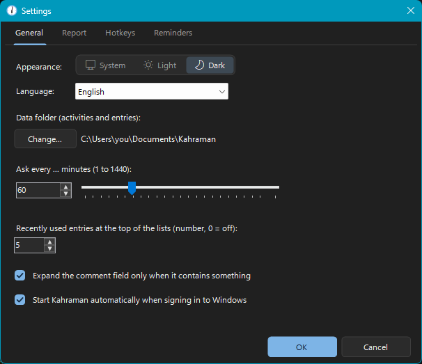
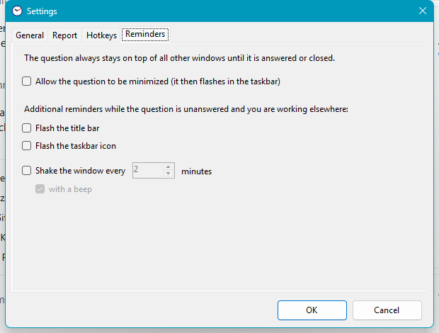
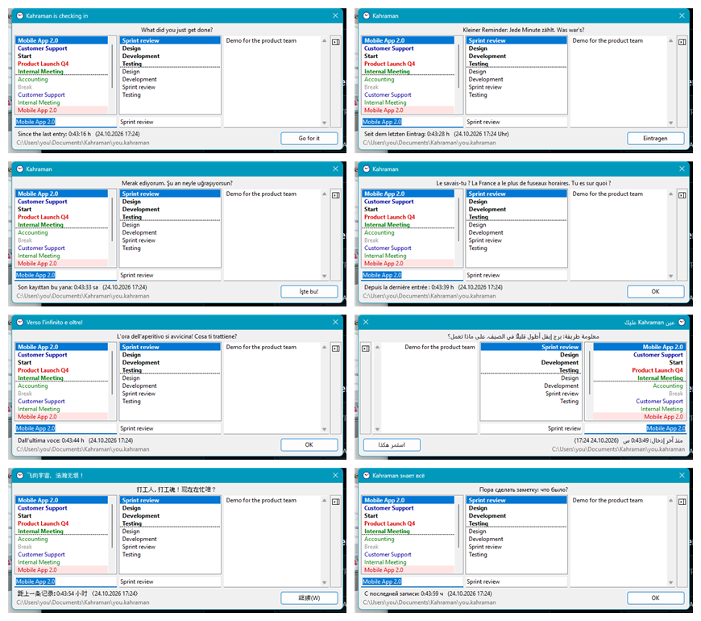

<p align="center">
  
</p>

<h1 align="center">Kahraman</h1>

<p align="center">
  <b>The time tracker that asks.</b><br>
  A tiny Windows tray app that pops up every now and then, asks what you're working on –<br>
  and turns your answers into a clean report of where your time actually went.
</p>

<p align="center">
  <a href="../../releases/latest"></a>
</p>

<p align="center">
  
  
  <a href="LICENSE"></a>
  
  
  <a href="CONTRIBUTING.md"></a>
</p>

<p align="center">
  
</p>

---

## Why Kahraman?

Most time trackers wait for you to press *start* and *stop* – and you forget both.
Kahraman flips it around: **it comes to you.** Every few minutes (you choose how often) a small window asks
*"What are you working on?"*. Pick an activity, optionally a sub-activity and a comment, press Enter – done in two seconds.
At the end of the week you know exactly how many hours went into which project.

It's also a little cheeky: the question changes every time, comes with fun facts, Monday-morning coffee reminders,
Friday-afternoon cheers – and the OK button might just say *"Go for it"*.

## Features

- ⏰ **Asks at your pace** – every 1 minute to 24 hours, or right now via double-click / global hotkey.
- ⚡ **Two-second entries** – type `ac` and Kahraman completes *Accounting*; your most recent activities are always on top.
- 🎨 **Colour-coded lists** – mark activities as general, project, important, unimportant or standard.
- 💬 **Smart fold-away fields** – the comment field (Alt+K) and the sub-activities (Alt+U) stay out of the way
  and open by themselves when there's something to show; Kahraman remembers how you like the sub-activities.
- 📊 **Reports** – day, week, month, quarter, year or any period; by activity, sub-activity or comment; hours and days;
  copy to Excel with one click, including per-day details.
- ✏️ **Edit history** – filter, correct, insert or rename past entries.
- 🔔 **Hard to ignore** – the question stays on top and can't be closed until it's answered; optionally the title bar
  or taskbar icon flashes, the window gives a gentle shake, or you allow minimising.
- 🌗 **Light and dark mode** – follows Windows or set it yourself, with a modern Windows 11 look.
- 👥 **Team friendly** – several people can share one data folder on a network drive: one shared activity list,
  one personal log file each.
- 🌍 **8 languages** – English, German, Turkish, French, Italian, Arabic (right-to-left), Chinese and Russian.
  Not just translated – the jokes are adapted for each language.
- 🔒 **Private by design** – plain text files in a folder of your choice. No account, no cloud, no telemetry.
- 📦 **Zero setup** – one single `.exe`, no .NET installation and no admin rights required.

## Screenshots

| Report | Settings |
|---|---|
|  | <br> |

### Speaks your language



Kahraman follows your Windows language automatically. You can switch it any time under
**Settings › General › Language**. Dates, times and decimal numbers follow your Windows region settings.

## Download & installation

### Microsoft Store

Kahraman is on its way to the Microsoft Store as **[Kahraman Time Tracker](https://apps.microsoft.com/detail/9N8VTGX1XRK1)**
(the link works once Microsoft has certified it). The Store version is signed by Microsoft, installs without any
warning, updates itself and can be switched off at sign-in under *Windows Settings › Apps › Startup*.

### Download from GitHub

1. Download **`Kahraman-<version>-win-x64.zip`** from the [latest release](../../releases/latest) and unzip it.
2. Start **`Kahraman.exe`**.
3. Windows may show *"Windows protected your PC"* because the app is not code-signed yet
   (see [Code signing policy](#code-signing-policy)): click **More info → Run anyway**.
4. Answer **Install Kahraman?** with **Yes** and confirm the license.

Kahraman copies itself to `%LOCALAPPDATA%\Programs\Kahraman`, adds a Start menu entry and starts automatically when
you sign in. Choose **No** to run it once without installing (portable).

**Update:** just run the newer `Kahraman.exe` and confirm – your data is kept.
**Uninstall:** *Windows Settings › Apps › Kahraman* – your data is kept.

Requirements: Windows 10 or 11, 64-bit.

## How your time is counted

- Every entry stands for the time **since the previous entry**.
- The first entry of a day only marks the start of work – just log *"Start"* in the morning.
- Hours are shown as decimals (1 h 15 min = 1.25); one day = 8 hours.

## Your data

Everything lives in a folder you pick (default: `Documents\Kahraman Time Tracking`):

| File | Content |
|---|---|
| `taetigkeiten.kahraman` | activities, sub-activities and templates (shared) |
| `<username>.kahraman` | your entries, one line each – readable plain text |

Kahraman keeps a `.bak` backup before every overwrite and never sends anything anywhere.

## Privacy

This program will not transfer any information to other networked systems unless specifically requested by the user
or the person installing or operating it.

Kahraman has no network code at all: no telemetry, no update check, no account. Your activities and entries stay in
the data folder you choose (if that is a network drive, only that drive is used).

## Code signing policy

- The **Microsoft Store** package is signed by Microsoft.
- The **GitHub downloads** are not code-signed yet, which is why Windows may warn when you start them.
- Every release is built from this repository's source code by [GitHub Actions](.github/workflows/build.yml);
  only packages built there are published.
- Committers and reviewers: [memoldinyo](https://github.com/memoldinyo)

## Build from source

Requirements: Windows and the [.NET 10 SDK](https://dotnet.microsoft.com/download).

```
git clone https://github.com/memoldinyo/kahraman.git
cd kahraman
dotnet build Kahraman.slnx
dotnet test tests/Kahraman.Core.Tests
```

`build-release.ps1` creates the self-contained single-file package in `dist/`, `build-msix.ps1` the Microsoft Store
package. Both run on GitHub Actions for every push; pushing a tag `vX.Y.Z` creates a draft release with the package
attached.
See [CONTRIBUTING.md](CONTRIBUTING.md) for the project layout, translations and how to send a pull request,
and [CHANGELOG.md](CHANGELOG.md) for what changed in each version.

## License

Kahraman is open source under the [Apache License 2.0](LICENSE) © 2026 Mehmet Aslandag – free to use, change and
share, privately and at work. See [NOTICE](NOTICE) for attributions; the release package includes the .NET runtime and
Windows Forms (MIT License, © .NET Foundation and Contributors), see `DRITTANBIETER-LIZENZEN.txt` in the download.

## Feedback

Found a bug or have an idea? Please [open an issue](../../issues) – feedback in any of the eight languages is welcome.
Pull requests are welcome too!
