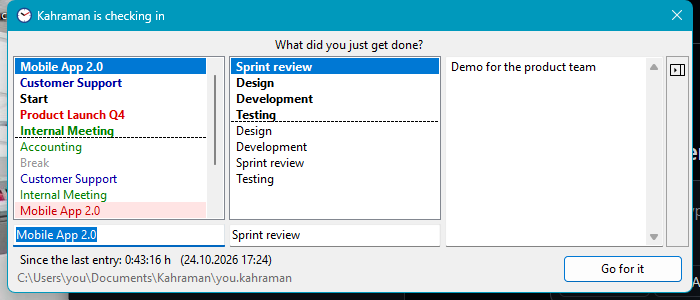
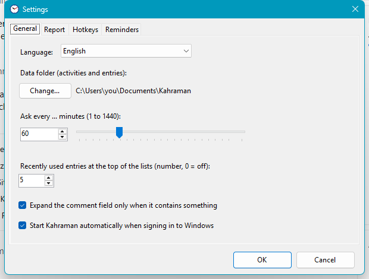

  

<h1 align="center">Kahraman</h1>

  <b>The time tracker that asks.</b> 
  A tiny Windows tray app that pops up every now and then, asks what you're working on – 
  and turns your answers into a clean report of where your time actually went.

  

  
  
  
  
  

  

---

## Why Kahraman?

Most time trackers wait for you to press *start* and *stop* – and you forget both.
Kahraman flips it around: **it comes to you.** Every few minutes (you choose how often) a small window asks
*"What are you working on?"*. Pick a project, optionally a sub-task and a comment, press Enter – done in two seconds.
At the end of the week you know exactly how many hours went into which project.

It's also a little cheeky: the question changes every time, comes with fun facts, Monday-morning coffee reminders,
Friday-afternoon cheers – and the OK button might just say *"Go for it"*.

## Features

- ⏰ **Asks at your pace** – every 1 minute to 24 hours, or right now via double-click / global hotkey.
- ⚡ **Two-second entries** – type `ac` and Kahraman completes *Accounting*; your most recent projects are always on top.
- 🎨 **Colour-coded lists** – mark projects as general, project, important, unimportant or standard.
- 💬 **Smart comment field** – stays out of the way and opens by itself when a project has a comment.
- 📊 **Reports** – day, week, month, quarter, year or any period; by project, sub-task or comment; hours and days;
  copy to Excel with one click, including per-day details.
- ✏️ **Edit history** – filter, correct, insert or rename past entries.
- 🔔 **Hard to ignore (if you want)** – the question stays on top until answered; optional flashing title bar or taskbar
  icon, a gentle shake, or allow minimising.
- 👥 **Team friendly** – several people can share one data folder on a network drive: one shared project list,
  one personal log file each.
- 🌍 **8 languages** – English, German, Turkish, French, Italian, Arabic (right-to-left), Chinese and Russian.
  Not just translated – the jokes are adapted for each language.
- 🔒 **Private by design** – plain text files in a folder of your choice. No account, no cloud, no telemetry.
- 📦 **Zero setup** – one single `.exe`, no .NET installation and no admin rights required.

## Screenshots

| Report | Settings |
|---|---|
|  |   |

### Speaks your language

Kahraman follows your Windows language automatically. You can switch it any time under
**Settings › General › Language**.

## Download & installation

1. Download **`Kahraman-<version>-win-x64.zip`** from the [latest release](../../releases/latest) and unzip it.
2. Start **`Kahraman.exe`**.
3. Windows may show *"Windows protected your PC"* because the app is not code-signed yet:
   click **More info → Run anyway**.
4. Answer **Install Kahraman?** with **Yes** and accept the license.

Kahraman copies itself to `%LOCALAPPDATA%\Programs\Kahraman`, adds a Start menu entry and starts automatically when
you sign in. Choose **No** to run it once without installing (portable).

**Update:** just run the newer `Kahraman.exe` and confirm – your data is kept.
**Uninstall:** *Windows Settings › Apps › Kahraman* – your data is kept.

Requirements: Windows 10 or 11, 64-bit.

## How your time is counted

- Every entry stands for the time **since the previous entry**.
- The first entry of a day only marks the start of work – just log *"Start"* in the morning.
- Hours are shown as decimals (1 h 15 min = 1.25); one day = 8 hours.

## Your data

Everything lives in a folder you pick (default: `Documents\Kahraman Time Tracking`):

| File | Content |
|---|---|
| `taetigkeiten.kahraman` | projects, sub-tasks and templates (shared) |
| `<username>.kahraman` | your entries, one line each – readable plain text |

Kahraman keeps a `.bak` backup before every overwrite and never sends anything anywhere.

## License

Kahraman is **freeware** © 2026 Mehmet Aslandag.
You may use it for free – privately and at work – and pass on the **unchanged** package for free.
Modifying, reverse engineering or selling it is not permitted. The source code is not published.

- [LICENSE.txt](LICENSE.txt) – English translation
- [LIZENZ.txt](LIZENZ.txt) – German original (legally binding)

Kahraman includes the .NET runtime and Windows Forms (MIT License, © .NET Foundation and Contributors);
see `DRITTANBIETER-LIZENZEN.txt` in the download.

## Feedback

Found a bug or have an idea? Please [open an issue](../../issues) – feedback in any of the eight languages is welcome.
